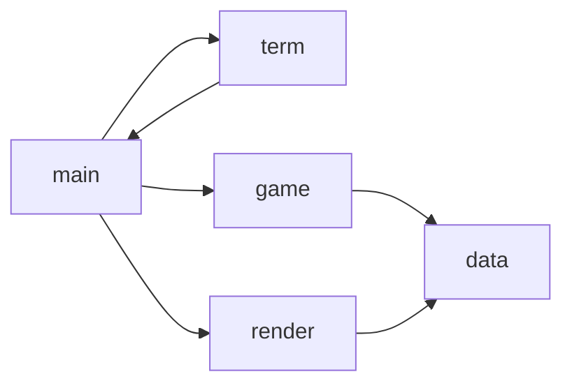

# ARM64 汇编俄罗斯方块 计划

来源: docs/brief.md

## 背景
在 macOS（Apple Silicon）上用纯 ARM64 汇编写一个终端俄罗斯方块：零 libc、只用系统调用、`ld` 直接链接。
作品展示用途，经典完整版玩法（移动/旋转/软降/硬降/消行计分/等级加速/下一块预览/暂停/重开/游戏结束）。
入口：`make` 构建 `./tetris`，终端交互游玩。

## 架构
| 文件 | 职责 | 对外接口 |
|---|---|---|
| Makefile | 构建（as + ld，零 libc） | `make` / `make clean` |
| src/main.s | 入口 `_main`、解析环境变量 SEED、主循环 | `_main`（链接入口） |
| src/term.s | 终端 raw mode 设置/恢复、按键解码 | `term_enter_raw()` `term_restore()` `key_read()→x0` |
| src/render.s | 整帧渲染（棋盘/HUD/预览/状态文字） | `render_frame()` |
| src/game.s | 游戏逻辑（碰撞/移动/旋转/下落/锁定/消行/计分/PRNG） | `game_reset()` `game_handle_key(x0)` `game_tick()` `collision(x0,x1,x2,x3)→x0` `rand_next()→x0` |
| src/data.s | 全部状态存储、方块表、速度/分数表、颜色与字符串 | 状态标签（见共享接口） |
| tests/play.py | 端到端脚本驱动测试（喂按键字节流，断言画面） | `python3 tests/play.py <case|all>` |



主循环顺序（钉死，测试的 tick 模型依赖它）：`render_frame() → k=key_read() → game_handle_key(k) → 若 k==K_NONE 则 tick_ctr++，达到 speed_tbl[level] 间隔则 tick_ctr=0 并 game_tick()`。tick 只由 K_NONE 推进：真终端空闲时 key_read 每 0.1s 超时返回一次 K_NONE（重力=每 0.1s 一步的停表，按键期间重力暂停）；管道喂键时 K_NONE 只来自未知字节（read 不超时），画面完全由喂入字节决定（确定性测试依赖它）。

## 约定
- 目标：macOS arm64；汇编器 `as -arch arm64`（Xcode CLT 的 clang 集成汇编器），链接 `ld -arch arm64 -e _main -o tetris build/*.o -syslibroot $(xcrun --sdk macosx --show-sdk-path) -l System`（已实测）。
- 零 libc：不调用任何 C 库函数；退出用 `SYS_exit` 直接终止。`-l System` 仅为 dyld 依赖，不引用其中符号。
- 调用约定：AAPCS64（参数 x0-x7，返回 x0，x19-x28 被调方保存，`bl`/`ret`，sp 16 字节对齐）。
- 语法：GNU 汇编 `.s`，注释用 `//`（实测 clang IAS 支持）；字符串地址 `adrp/add`，大立即数 `movz/movk`。
- 代码组织：按上表分文件；单文件超过约 300 行就停下来报告；不建"杂物"文件。
- 风格：标签 snake_case；数据一律 `.balign 4`；无特殊说明时 word 用 32 位（`w` 寄存器）。
- 运行：`./tetris`；固定序列：`SEED=<1..2^31-1> ./tetris`（测试依赖它）。

## 检查
每个任务 verify 时都会自动运行（汇编器即语法检查；本项目无独立 linter）。
```bash
make clean && make
```

## 共享接口
跨任务使用的标签与约定只在这里定义一次。任务按名称引用，不得修改。

### 系统调用与常量（本机实测 + 系统头文件，2026-10-14，SDK MacOSX.sdk）
- 调用形式：`mov x16, <号>` → 参数 x0.. → `svc #0x80`；返回值 x0。
- 号：exit=1，read=3，write=4，ioctl=54，gettimeofday=116。
- ioctl：`TIOCGETA=0x40487413`（读 termios），`TIOCSETA=0x80487414`（写回）。
- termios 结构（共 72 字节，留 80）：c_iflag@0、c_oflag@8、c_cflag@16、c_lflag@24（各 8 字节），c_cc[20]@32，VMIN=16、VTIME=17（即 c_cc 下标）。
- raw mode：`c_lflag &= ~0x588`（ECHO 0x8|ICANON 0x100|ISIG 0x80|IEXTEN 0x400，实测 SDK 头文件；漏 ISIG 会让 Ctrl-C 杀进程且不恢复终端），`c_iflag &= ~0x300`（IXON|ICRNL），`c_cc[VMIN]=0, c_cc[VTIME]=1`（read 最多等 0.1 秒，即主循环的 tick 源）。

### 键码（key_read 返回值，x0）
| 值 | 含义 | 输入 |
|---|---|---|
| 0 | K_NONE（超时或未知字节；唯一推进 tick_ctr 的键） | 0.1s 到期 / 未匹配字节 |
| 1 | K_LEFT | `ESC [ D` |
| 2 | K_RIGHT | `ESC [ C` |
| 3 | K_DOWN（软降一格） | `ESC [ B` 或 `j` |
| 4 | K_ROT（顺时针旋转） | `ESC [ A` 或 `k` |
| 5 | K_HARD（硬降） | 空格 |
| 6 | K_PAUSE | `p` |
| 7 | K_QUIT | `q`，或 read 返回 0（EOF） |
| 8 | K_RESTART | `r` |

key_read 内部：一次 `read(0, buf, 8)`；维护 8 字节缓冲 + 剩余字节数（一次 read 可能含多个键），每次调用从缓冲解析一个键，不足时再 read。字节流按上表匹配：先看 `ESC [ X` 三字节，再看单字节命令。未知字节 → K_NONE。

### 游戏状态（data.s 中的标签，全部 .global）
```
board:      .space 200   // 10x20，每格 1 字节：0 空，1-7=方块类型+1；行 y 列 x -> board[y*10+x]
cur_type/cur_rot/cur_x/cur_y: .word  // 当前块：类型 0-6，旋转 0-3，锚点列 0-9，锚点行（可为 0-19）
next_type:  .word        // 下一块类型 0-6
score/lines_total/level: .word
tick_ctr:   .word        // 收到 K_NONE 时 +1，达到间隔清零并 game_tick()
game_over_f/paused_f: .word  // 0/1
prng_state: .word        // xorshift32 状态，非 0
init_seed:  .word        // _main 解析 SEED 存入；game_reset 用它重置 prng_state
```
`term_raw_ok`（raw 设置成功标志）与 `term_saved`（保存的 termios，80 字节）在 **term.s** 定义（T01），不在 data.s——避免 T02 建全量标签时重复定义。

### 方块表（pieces，224 字节：7 型 × 4 旋转 × 4 格 × `.byte dx,dy`，y 向下为正，锚点(0,0)）
生成规则：`r[k+1] = 把 r[k] 每格 →(-dy,dx)`；O 型四个旋转钉为同一形态。
```
// I(0)
.byte -1,0, 0,0, 1,0, 2,0      // rot0
.byte 0,-1, 0,0, 0,1, 0,2      // rot1
.byte 1,0, 0,0, -1,0, -2,0     // rot2
.byte 0,1, 0,0, 0,-1, 0,-2     // rot3
// O(1)：四态同形
.byte 0,0, 1,0, 0,1, 1,1       // rot0..rot3 全部相同
.byte 0,0, 1,0, 0,1, 1,1
.byte 0,0, 1,0, 0,1, 1,1
.byte 0,0, 1,0, 0,1, 1,1
// T(2)
.byte -1,0, 0,0, 1,0, 0,1
.byte 0,-1, 0,0, 0,1, -1,0
.byte 1,0, 0,0, -1,0, 0,-1
.byte 0,1, 0,0, 0,-1, 1,0
// S(3)
.byte 0,0, 1,0, -1,1, 0,1
.byte 0,0, 0,1, -1,-1, -1,0
.byte 0,0, -1,0, 1,-1, 0,-1
.byte 0,0, 0,-1, 1,1, 1,0
// Z(4)
.byte -1,0, 0,0, 0,1, 1,1
.byte 0,-1, 0,0, -1,0, -1,1
.byte 1,0, 0,0, 0,-1, -1,-1
.byte 0,1, 0,0, 1,0, 1,-1
// J(5)
.byte -1,0, 0,0, 1,0, -1,1
.byte 0,-1, 0,0, 0,1, -1,-1
.byte 1,0, 0,0, -1,0, 1,-1
.byte 0,1, 0,0, 0,-1, 1,1
// L(6)
.byte -1,0, 0,0, 1,0, 1,1
.byte 0,-1, 0,0, 0,1, -1,1
.byte 1,0, 0,0, -1,0, -1,-1
.byte 0,1, 0,0, 0,-1, 1,-1
```

### 其他表与算法（data.s / game.s）
- `speed_tbl`：10 个 word，等级 0-9 每次下落间隔 tick 数 `[10,8,7,6,5,4,3,2,2,1]`（1 tick=0.1s）。`level = min(9, lines_total/10)`。
- `score_tbl`：5 个 word `[0,100,300,500,800]`；一次消 n 行加 `score_tbl[n] * (level+1)`。
- PRNG：xorshift32：`x^=x<<13; x^=x>>17; x^=x<<5`（每步后保持 32 位）；`rand_next()` 推进 `prng_state` 并返回 `x0 = prng_state % 7`（udiv）。
- 出生/流程：`game_reset()` 清空全部状态，`prng_state=init_seed`（若为 0 则 `_main` 已用时间填），`next_type=rand_next()`，再 spawn。spawn：`cur_type=next_type; next_type=rand_next(); cur_x=4; cur_y=0; cur_rot=0`；若出生位碰撞 → `game_over_f=1`。
- `collision(px,py,type,rot)→x0`（1=碰）：逐格 `nx=px+dx, ny=py+dy`；非法当 `nx<0 || nx>9 || ny>19 || (ny>=0 && board[ny*10+nx]!=0)`。`ny<0`（棋盘上方）不算碰。
- 锁定：把当前块 4 格写入 board（值 = cur_type+1）。
- 硬降：`while !collision(x,y+1): y++`，然后走锁定。

### 画面格式（render_frame 输出一帧，钉死，测试按它解析）
一次 `write(1, 全帧)`，先在静态缓冲区拼好。帧内容依序：
1. `ESC[2J ESC[H`（清屏回原点）
2. 标题行：`TETRIS (ARM64)`
3. 20 行棋盘：`|` + 10 格 + `|`；每格 2 字符：实心= `ESC[3<N>m` + `[]` + `ESC[0m`（N=31+类型，按格内值-1），空格= `. `。当前块自 T03 起叠加渲染：按 cur_type/cur_rot/cur_x/cur_y 把 4 格以相同实心格式画进对应行（board 值优先，两处不会重叠；ny<0 的格不画）
4. 底边框：`+` + 20 个 `-` + `+`
5. HUD：`SCORE <十进制>`、`LEVEL <十进制>`、`LINES <十进制>`
6. NEXT 预览 2 行：预览窗口 4 列 c=0..3 对应 dx=c-1（窗口覆盖 dx=-1..2，7 型 rot0 的 dx 均在 -1..2 内，任何块 4 格全可见）：第 1 行 `NEXT ` + pieces[(next_type,0)] 中 dy=0 的格（实心同上着色，其余列两空格）；第 2 行 5 空格 + dy=1 的格
7. 状态行（互斥优先级）：`game_over_f` → `GAME OVER  R=restart`；`paused_f` → `PAUSED`
8. 帮助行：`←→ move · ↓ soft · ↑ rotate · space drop · p pause · r restart · q quit`

十进制输出：`emit_dec(w)`，用 `udiv`/`msub` 除 10 取余，逆序拼入帧缓冲。

### tests/play.py 骨架（T02 建立，逐任务追加 case）
```python
import os, re, subprocess, sys
BIN = "./tetris"
def run(keys: bytes, seed=None, env=None):
    e = dict(os.environ); e.pop("SEED", None)
    if seed is not None: e["SEED"] = str(seed)
    if env: e.update(env)
    p = subprocess.run([BIN], input=keys, capture_output=True, env=e, timeout=30)
    return p.returncode, p.stdout
def frames(out): return out.split(b"\x1b[2J")[1:]      # 每帧含 ESC[H 起
def board_rows(frame): return [l for l in frame.split(b"\n") if l.startswith(b"|")]
CASES = {}
# 各任务在这里追加 CASES["tXX"] = fn，断言失败抛异常
if __name__ == "__main__":
    names = sys.argv[1:]
    if names == ["all"]: names = list(CASES)
    for n in names:
        CASES[n](); print(n, "PASS")
```
换行用 `\n`（渲染时每行尾输出 `\n`，write 一次）。

## 错误策略
只处理下面列出的失败；其他系统调用失败不检查、不捕获、不兜底、不重试。
| 失败 | 在哪一层处理 | 表现 |
|---|---|---|
| stdin 不是 tty（ioctl TIOCGETA 返回非 0，如管道测试） | term_enter_raw | `term_raw_ok=0`：跳过 raw 设置，游戏照常运行（管道可测性依赖此分支） |
| read 返回 0（EOF，管道关闭） | key_read | 返回 K_QUIT，走正常退出路径 |
| 退出路径（QUIT 键或 EOF） | main | `term_raw_ok=1` 时先 `term_restore()`（写回保存的 termios）再 `exit(0)`；恢复失败不管 |

键盘输入是单人本机的信任输入，除键码匹配外不做校验。

## 风险与探针
规划期已在本机实测（临时目录，不进仓库）：
- 构建链：`as -arch arm64` + `ld -arch arm64 -e _main ... -syslibroot ... -l System` 产出可运行二进制 ✓
- `svc #0x80` + x16 传号：write/read/ioctl/exit 全部实测 ✓；ioctl 在管道上失败降级、read EOF 返回 0 ✓
- 常量出处：`/Library/Developer/CommandLineTools/SDKs/MacOSX.sdk` 的 `sys/syscall.h`、`sys/termios.h`（C 探针打印）
剩余风险：
- **golden 逐键一致**：T04/T05 的验证值来自钉死模型（主循环顺序、tick 只由 K_NONE 推进、旋转表、PRNG、碰撞规则）下的 python 推演，且经第二个独立实现重放复核（T04：13 块 GAME OVER；T05：60 锁定 LINES 16 / SCORE 2600 / LEVEL 1）。若实测值不符，说明实现偏离接口，优先改实现；两回合仍不符再回来改计划并重新冻结 golden 值。
- 真实 TTY 下的交互手感（闪烁、延迟）管道测试覆盖不到，T03/T07 里程碑人工确认。

## 任务

### T01 端到端骨架：构建 + raw mode + 按键循环 + 干净退出
- [x] 完成
依赖: 无
文件: Makefile(新增), src/main.s(新增), src/term.s(新增)
接口: 提供 `term_enter_raw` `term_restore` `key_read`（键码表）；`_main`
要点:
- Makefile：`SRCS=$(wildcard src/*.s)` → `build/%.o`（`as -arch arm64`）→ 链接命令见"约定"（含 `mkdir -p build`）；`make clean && make` 必须零警告通过。
- `_main`：不碰 argc/argv 也能跑；先 `bl term_enter_raw`，`write(1, "TETRIS (ARM64)\n", 15)`，进入主循环。
- term_enter_raw：栈上留 160 字节（termios 72 + 保存副本 72）；`ioctl(0, 0x40487413, buf)` 失败 → `term_raw_ok=0` 直接返回；成功则按"共享接口"的掩码改写（lflag `bic 0x588`、iflag `bic 0x300`、`c_cc[16]=0, c_cc[17]=1`），再 `ioctl(0, 0x80487414, buf)`，`term_raw_ok=1`。`term_raw_ok`（word）与 `term_saved`（80 字节）定义在 term.s 的 .bss，`.global`——它们属于 term.s，不进 data.s。
- key_read：缓冲+剩余字节模型（见共享接口）；`read(0, .., 8)` 返回 0 → K_QUIT。解码只认 9 种键。
- 主循环：`k=key_read()`；`k==K_QUIT` → 退出路径（restore → `write(1,"\n",1)` → `exit(0)`）；否则循环（其他键本任务忽略）。
- 系统调用样板（实测）：`mov x0,..; mov x16,#4; svc #0x80`。
验证:
```bash
make clean && make
python3 -c "import subprocess as s; r=s.run(['./tetris'],input=b'q',capture_output=True); assert r.returncode==0 and b'TETRIS' in r.stdout, (r.returncode, r.stdout[:80])"
python3 -c "import subprocess as s; r=s.run(['./tetris'],input=b'',capture_output=True); assert r.returncode==0, r.returncode"
python3 -c "import subprocess as s; r=s.run(['./tetris'],input=b'\x1b[Cx\x1b[Dq',capture_output=True); assert r.returncode==0 and b'TETRIS' in r.stdout"
```
完成标准: 零 libc 构建通过；喂 `q`、喂 EOF、喂杂键+`q` 三种输入都退出码 0 且无崩溃。

### T02 渲染：状态存储 + 整帧画面 + 端到端测试骨架
- [x] 完成
依赖: T01
文件: src/data.s(新增), src/render.s(新增), src/main.s(修改), tests/play.py(新增)
接口: 提供 `render_frame`、共享接口里的全部游戏状态标签（board/cur_*/next_type/score 等与字符串颜色表；term_* 在 term.s，T01 已有）；使用 `term_*`
阅读: src/term.s
要点:
- data.s：状态标签全零初始化（`.balign 4`）；颜色 7 组：`"\x1b[31m"`..`"\x1b[37m"` 加 `"\x1b[0m"`；标题/帮助/键名等字符串（`\n` 结尾）。
- render.s：静态帧缓冲（.bss，4096 字节）+ 追加指针 `sb_ptr`；`emit(x0=src, x1=len)` 追加。按"画面格式"1-8 依序拼帧（本任务无方块：棋盘全 `. `，NEXT 两行空白格，状态行不出现），最后 `write(1, sb, sb_ptr-sb)`。
- emit_dec：`udiv`/`msub` 循环除 10，余数逆序；SCORE/LEVEL/LINES 用它（当前都是 0）。
- main.s：主循环改为 `render_frame → key_read → （仍只处理 QUIT）`。
- tests/play.py：按共享接口骨架实现 `run/frames/board_rows`；case `t02`：SEED 无关键 `b'xq'`（未知键 'x' 也产生一帧）一局 → 断言 returncode==0；`b'TETRIS (ARM64)'`、`b'SCORE 0'`、`b'LEVEL 0'`、`b'LINES 0'`、`b'NEXT'` 在输出中；最后一帧 `len(board_rows)==20` 且每行 `b'|'+20字符+b'|'`；帧数==2；两次运行 stdout 完全相等（确定性）。
验证:
```bash
make clean && make
python3 tests/play.py t02
```
完成标准: `python3 tests/play.py t02` 打印 PASS；画面 20 行棋盘 + HUD 骨架可解析且逐字节确定。

### T03 方块、移动、重力、锁定、游戏结束（里程碑）
- [x] 完成
依赖: T02
文件: src/game.s(新增), src/data.s(修改), src/main.s(修改), src/render.s(修改), tests/play.py(修改)
（5 个文件，超出 4 文件上限：为了让"方块随键移动并自动下落"这个用户可见行为一次到位，接受例外）
接口: 提供 `game_reset` `game_handle_key` `game_tick` `collision` `rand_next`；使用状态标签、pieces/speed 表、键码
阅读: src/render.s
要点:
- render.s 追加当前块叠加：按画面格式第 3 条把 cur 4 格画进棋盘行（board 值优先；ny<0 的格不画）。
- data.s 追加：`pieces`（224 字节，照共享接口逐字节抄）、`speed_tbl`。
- game_reset：清 board/分数/等级/tick/标志，`prng_state=init_seed`，`next_type=rand_next()`，然后 spawn（接口定义）；init_seed 为 0 的兜底在 `_main` 完成。
- game_handle_key(k)：`game_over_f` 时只认 K_RESTART（本任务=重新 reset）；`paused_f` 本任务恒 0。K_LEFT：`!collision(cur_x-1,cur_y,..)` 则 cur_x--；K_RIGHT 同理；K_DOWN：能降则 cur_y++。
- game_tick：`game_over_f=1` 直接返回（死局后棋盘冻结）；碰撞(cur_x,cur_y+1) → 锁定 4 格 → spawn（若出生碰撞 → game_over_f=1，本任务不渲染该文字）；否则 cur_y++。
- _main 开头：解析 SEED（裁定 T03-1：本机入口栈无标准 argc/argv/envp 布局，改为在入口栈参数页内字节扫描 `SEED=`，解析十进制 1..2^31-1 写 `init_seed`；不匹配/越界 → `gettimeofday`（x0=栈上 16 字节缓冲）取 tv_usec 低 32 位 `orr #1`）；然后 `bl game_reset` 再进循环。主循环接上：K_LEFT/RIGHT/DOWN → handle_key；按钉死顺序只在 k==K_NONE 时 tick_ctr++，达到 speed_tbl[level] → 清零并 `bl game_tick`。K_QUIT 退出，其余键忽略。
- 测试 case `t03`（SEED=7，首块是 I）：
  a) 两次 `run(b'q', seed=7)` stdout 相等；
  b) `run(b'\x1b[D\x1b[D\x1b[Dq', 7)` 与 `run(b'q', 7)` 不等；两者最后一帧彩色实心格（`b'[]'` 计数）都 == 4（预览框本任务还是空白）；
  c) `run(b'x'*250+b'q', 7)`：最后一帧 `[]` 计数 > 4（发生过锁定）且 `b'SCORE 0'`、`b'LINES 0'` 在最后一帧（本任务无消行/计分）。
- 里程碑人工项：真终端跑一局，确认块随方向键移动、约每秒自动下落一格、落底锁定出新块。
验证:
```bash
make clean && make
python3 tests/play.py t03
```
完成标准: a/b/c 全过；交互确认"棋盘+自动下落"（简报样例 1 的画面部分）。

### T04 旋转与硬降、GAME OVER 画面
- [x] 完成
依赖: T03
文件: src/game.s(修改), src/render.s(修改), src/main.s(修改), tests/play.py(修改)
接口: 使用 collision/锁定路径；提供 K_ROT/K_HARD 行为与 GAME OVER 状态行
阅读: src/data.s
要点:
- game_handle_key 追加：K_ROT：`cur_rot=(cur_rot+1)&3` 前 `!collision(cur_x,cur_y,type,new_rot)` 才改（碰撞则不动，O 型四态同表自然成立）；K_HARD：`while !collision(cur_x,cur_y+1): cur_y++` 后走 game_tick 的锁定+spawn 路径（抽成内部子程序 `lock_and_spawn` 供 tick 与硬降共用）。
- render.s 状态行：`game_over_f=1` 时输出 `GAME OVER  R=restart`（优先于一切状态行）。
- game_handle_key：`game_over_f=1` 时 K_RESTART → `game_reset()`（含 prng 重播种）。
- 测试 case `t04`（golden 出自规划期推演）：
  a) `run(b'\x1b[Aq', 7)` ≠ `run(b'q', 7)`（首块 I 竖起，画面不同）；
  b) `run(b' '*70+b'q', 7)`：returncode==0，`b'GAME OVER'` 在输出中；最后一帧含 `b'SCORE 0'`、`b'LINES 0'`（推演：13 块堆顶，0 消行 0 分）；
  c) b) 再跑一次与上次 stdout 完全相等。
验证:
```bash
make clean && make
python3 tests/play.py t04
```
完成标准: 硬降 70 次后出现 GAME OVER 且终局 SCORE 0 / LINES 0；两次运行逐字节一致。

### T05 消行、计分、等级（里程碑）
- [x] 完成
依赖: T04
文件: src/game.s(修改), src/data.s(修改), tests/play.py(修改)
接口: 提供 `clear_lines`（内部）与计分/等级规则；data 追加 `score_tbl`
阅读: src/render.s
要点:
- `lock_and_spawn` 在锁定后调消行：y 从 19 往 0 扫，整行 10 格非 0 → 删除该行并把上方整体下移一行（memmove 语义：自底向上逐行 `ldr/str` 或按字节循环），行数 n 累计；`score += score_tbl[n]*(level+1)`；`lines_total += n`；`level = min(9, lines_total/10)`（udiv）。
- data.s 追加 `score_tbl: .word 0,100,300,500,800`。
- 测试 case `t05`（golden，规划期贪心推演冻结；脚本 269 键 685 字节）：
  脚本常量照抄进 play.py：
  `GOLDEN = b'\x1b[A\x1b[A\x1b[D\x1b[D\x1b[D \x1b[A\x1b[D \x1b[A\x1b[A\x1b[A\x1b[D\x1b[D\x1b[D\x1b[D  \x1b[A\x1b[A \x1b[C\x1b[C\x1b[C \x1b[A\x1b[A\x1b[D\x1b[D \x1b[C\x1b[C \x1b[A\x1b[A\x1b[A\x1b[C\x1b[C\x1b[C\x1b[C \x1b[A\x1b[A\x1b[C\x1b[C \x1b[A\x1b[C\x1b[C\x1b[C\x1b[C\x1b[C \x1b[C\x1b[C  \x1b[C\x1b[C \x1b[A\x1b[A\x1b[D\x1b[D\x1b[D \x1b[A\x1b[A\x1b[D\x1b[D \x1b[A\x1b[D\x1b[D\x1b[D\x1b[D \x1b[A\x1b[A\x1b[A\x1b[D\x1b[D\x1b[D \x1b[C \x1b[A\x1b[C\x1b[C\x1b[C\x1b[C\x1b[C \x1b[A\x1b[A\x1b[A\x1b[D \x1b[A\x1b[C\x1b[C\x1b[C\x1b[C \x1b[A\x1b[A\x1b[D\x1b[D \x1b[A\x1b[A\x1b[A\x1b[D\x1b[D\x1b[D\x1b[D \x1b[A\x1b[D\x1b[D\x1b[D  \x1b[C\x1b[C \x1b[C\x1b[C\x1b[C\x1b[C \x1b[D \x1b[A\x1b[C\x1b[C\x1b[C\x1b[C\x1b[C \x1b[D \x1b[C\x1b[C \x1b[A\x1b[A\x1b[A\x1b[C \x1b[A\x1b[C\x1b[C\x1b[C\x1b[C\x1b[C \x1b[A\x1b[C\x1b[C\x1b[C\x1b[C\x1b[C \x1b[D \x1b[A\x1b[A\x1b[D\x1b[D\x1b[D \x1b[A\x1b[C\x1b[C\x1b[C \x1b[D\x1b[D\x1b[D \x1b[A\x1b[C \x1b[D \x1b[D\x1b[D \x1b[A\x1b[C\x1b[C \x1b[C\x1b[C\x1b[C\x1b[C \x1b[A\x1b[A\x1b[A\x1b[D\x1b[D\x1b[D\x1b[D  \x1b[D \x1b[A\x1b[A\x1b[C\x1b[C\x1b[C\x1b[C \x1b[A\x1b[A\x1b[D\x1b[D\x1b[D \x1b[C\x1b[C\x1b[C \x1b[A\x1b[A\x1b[D\x1b[D \x1b[A \x1b[A\x1b[C\x1b[C \x1b[C\x1b[C\x1b[C \x1b[D\x1b[D\x1b[D \x1b[C\x1b[C \x1b[D\x1b[D \x1b[A \x1b[A\x1b[C\x1b[C\x1b[C\x1b[C\x1b[C \x1b[A\x1b[A\x1b[A\x1b[D\x1b[D\x1b[D\x1b[D q'`
  a) `run(GOLDEN, 2)`：最后一帧含 `b'LINES 16'`、`b'SCORE 2600'`、`b'LEVEL 1'`；输出不含 `b'GAME OVER'`（按钉死模型双人独立重放结果一致：60 块已锁定，第 61 块在场，无死局）；
  b) a) 重跑 stdout 完全相等；
  c) 逐帧 LINES 单调不减且最大值等于终值（`re.findall(rb'LINES (\d+)', out)`）。
- 里程碑人工项：真终端玩一局，确认满行消除、分数按 100/300/500/800 跳变、每 10 行升级加速（简报样例 2、4）。
验证:
```bash
make clean && make
python3 tests/play.py t05
```
完成标准: 冻结脚本精确跑出 LINES 16 / SCORE 2600 / LEVEL 1 且逐帧单调；交互确认计分与加速。

### T06 暂停、下一块预览、重开
- [x] 完成
依赖: T05
文件: src/game.s(修改), src/render.s(修改), tests/play.py(修改)
接口: 提供 paused_f 行为、NEXT 预览渲染、任意时刻 K_RESTART
阅读: src/data.s
要点:
- game_handle_key 追加 K_PAUSE：翻转 `paused_f`。`paused_f=1` 时：移动/旋转/软降/硬降键全部忽略（只有 p/q/r 生效）。
- game_tick：`paused_f=1` 直接返回（重力停）；暂停期间 K_NONE 照常累计 tick_ctr、达到间隔也调 game_tick，但它立即返回——行为等价于停表。
- K_RESTART 提升为任意时刻可用：直接 `game_reset()`（含 prng 重播种到 init_seed，画面回到首块）。
- render.s：NEXT 两行按"画面格式"第 6 条画 `pieces[(next_type,0)]` 的 dy=0/dy=1 格；状态行追加 `paused_f=1` → `PAUSED`（GAME OVER 优先）。
- 测试 case `t06`（SEED=7）：
  a) `run(b'q', 7)` 最后一帧 `b'[]'` 计数 == 8（当前块 4 + 预览 4）；
  b) `run(b'p'+b'x'*30+b'q', 7)`：输出含 `b'PAUSED'`；其最后一帧的 board_rows 与 `run(b'q',7)` 最后一帧的 board_rows 相等（暂停期间棋盘没动）；
  c) `run(b'x'*30+b'q', 7)` 的 board_rows 与 `run(b'q',7)` 的不等（不暂停时 30 tick 掉了 3 格）；
  d) `run(b' '*70+b'r'+b'q', 7)`：最后一帧 board_rows == `run(b'q',7)` 的 board_rows（重开清盘重播种，画面回到首块）。
验证:
```bash
make clean && make
python3 tests/play.py t06
```
完成标准: a-d 全过；p 键画面定格、r 键回到开局局面。

### T07 收尾：README 与全量回归（里程碑）
- [x] 完成
依赖: T06
文件: README.md(新增)
接口: 无
阅读: tests/play.py
要点:
- README.md：项目一句话介绍；构建与运行（Xcode CLT 前提）；键位表（与共享接口键码一致）；`SEED=` 固定序列说明；架构一节（5 个 .s 文件职责表）。
- 全量回归 + 简报四条验收样例逐条人工过一遍：
  1. `make && ./tetris` → 棋盘/预览/分数/等级、自动下落；
  2. 方向键+空格 → 即时响应、消行加分；
  3. 堆顶 → GAME OVER、R 重开、Q 恢复终端退出；
  4. 每 10 行升级加速。
验证:
```bash
make clean && make
python3 tests/play.py all
python3 -c "t=open('README.md').read(); assert 'make' in t and 'SEED' in t and ('←' in t or 'rotate' in t or '旋转' in t), t[:200]"
```
完成标准: `t02..t06` 全 PASS；README 覆盖构建/键位/SEED；人工过四条验收样例并记录结果。

## 裁定记录
- T01：key_read 中 read 返回 0 的语义 → 按 term_raw_ok 区分：raw 模式=VTIME 0.1s 超时返回 K_NONE（tick 源），非 raw（管道）=EOF 返回 K_QUIT；理由：共享接口同时规定"K_NONE 来自 0.1s 到期"与"EOF→K_QUIT"，若无条件 K_QUIT 则真终端空闲 0.1s 即退出，此为两条规则唯一一致读法，且不影响管道验证。
- T03：共享接口假设的入口栈布局（[sp]=argc，NULL，envp）在 macOS 26 arm64 直链接二进制上实测不成立（argc 在原始 sp+0x88，envp 指针数组解引用段错误）→ SEED 解析改为入口栈参数页内字节扫描 `SEED=`，理由：无指针解引用、兼容布局变化；探针实测 SEED=1/7123/未设/非法 四路径均正确。
- T03：t02 断言"行宽 22"与"无 SEED 两次运行相等"在 T03 渲染当前块（ANSI 颜色码 + PRNG 块型）后过时 → 前者剥 ANSI 后校验 22，后者改为固定 SEED=1 对比两次运行，理由：与共享接口"画面格式"一致，保留原断言意图（确定性）。
- T03：tests/play.py 中 worker 遗留两个重复 `def t03()`（后者覆盖前者）→ 删除第一个，理由：消除歧义。
- T04：卡片遗漏 src/main.s——T03 主循环只转发键码 1-3，K_ROT(4)/K_HARD(5) 永远到不了 game_handle_key → 卡片文件清单纳入 main.s，主循环转发上限从 #3 改 #5（6-8 仍忽略，T06 接管），理由：无此改动卡片核心行为（硬降 70 次 GAME OVER）必然不可达；worker 已在隔离副本实证单行修复后 t02/t03/t04 全 PASS。
- T05：worker 发现 T03 遗留 bug——pieces 下标 `add w9, w9, w10, lsl #2` 实为 `type+rot*4`（注释却写 type*4+rot），碰撞/锁定/显示全按错误旋转形状工作 → game.s（lock_and_spawn，worker 修）与 render.s（curmap_fill，总控修）统一改为 `rot + type*4`，理由：golden 冻结值（60 锁/2600/16/1）基于正确形状模型，修复后精确命中。
- T06：卡片再次遗漏 src/main.s——主循环 #5 上限把 K_PAUSE(6)/K_RESTART(8) 丢弃 → 接线转发（原注释即预留"T06 再接"）；t03 断言"末帧 []==4"写于预览空白期，按画面格式第 6 条更新为 ==8（当前块 4 + 预览 4），理由：与 t06 a) 钉死值一致。
